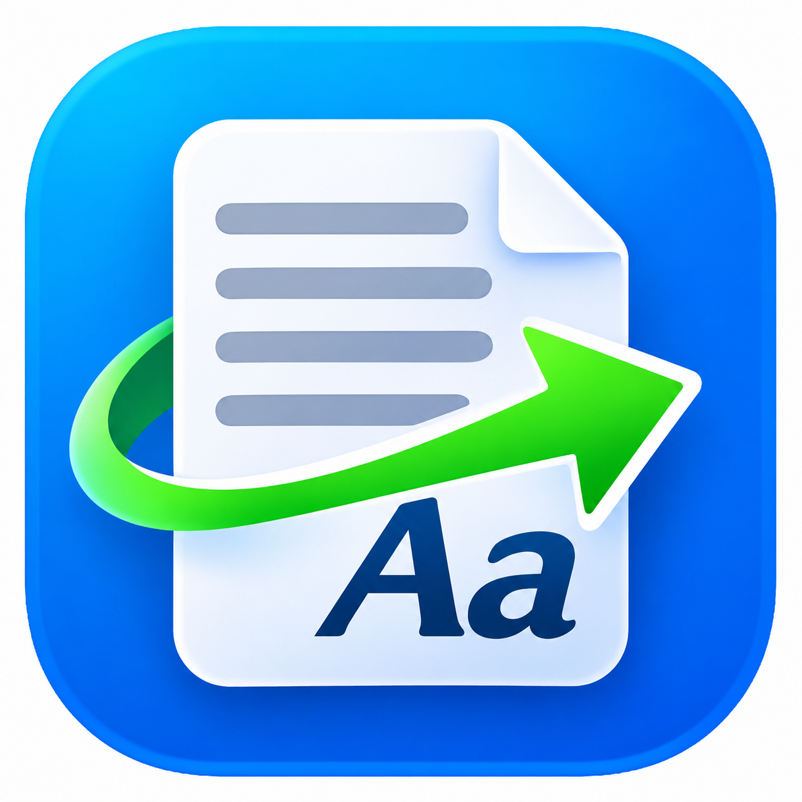

# CopyFix

**English** · [Русский](README.ru.md)

**A little help for text that didn't survive copy and paste.**

Copy a paragraph from a PDF, paste it into an email, and suddenly every line ends in the middle of a sentence. Sometimes words are split by hyphens. Sometimes the spacing has a life of its own. Fixing it by hand is easy enough, but doing it over and over gets old.

CopyFix takes care of that small, surprisingly persistent annoyance. It's a tiny Windows utility that tidies up text already on your clipboard, so you can get back to what you were actually doing.

It works **offline**, stays out of your way in the system tray, and lets you review changes that might need a human decision.

**[Download CopyFix for Windows](https://github.com/StanleyLl0yd/copyfix/releases/latest)** · [Browse all releases](https://github.com/StanleyLl0yd/copyfix/releases)

## From messy paste to readable text

CopyFix is especially handy for paragraphs copied from PDFs, documents and web pages. Depending on the selected mode, it can:

- Tidy up extra spaces, blank lines and line endings.
- Suggest joining lines that were wrapped in the middle of a paragraph.
- Suggest reconnecting words split across lines, while trying to preserve meaningful hyphens.
- Show the original and proposed text side by side, highlighting what's changed.

It isn't a spellchecker or an AI writer. It doesn't try to improve your prose or guess what you meant. Structured content, such as code and data, is handled conservatively; if the result is uncertain, **you get to decide before the clipboard changes**.

## How to use it

1. Download \`CopyFix.exe\` from the latest release and run it. No installer or administrator rights are needed.
2. Copy some text as usual.
3. Press **Ctrl+Alt+F9** (you can change the shortcut), or choose **Fix text** from the tray menu.
4. If a preview appears, check the highlighted changes and apply or cancel them. Then paste with **Ctrl+V**.

Changed your mind? **Undo** in the tray can restore the previous plain text, as long as the clipboard hasn't been replaced by a newer copy.

### Three ways to clean up

| Mode | Best for |
| --- | --- |
| **Gentle** | Cleaning up spaces, line endings and extra blank lines with minimal intervention. |
| **Smart** | Suggesting fixes for awkward line breaks inside ordinary paragraphs. |
| **Deep** | Also looking for words broken by end-of-line hyphens. This is the default for a new installation. |

You can switch modes in Settings. The app speaks **English and Russian**, with a manual language choice or automatic detection from Windows. It also offers **system, light and dark** appearance modes.

## Small, local, and deliberately simple

CopyFix is a single portable executable for **Windows 10 and 11 (x64)**. There is no account, cloud service, clipboard history, advertising, telemetry, or background clipboard monitoring. It only processes text when you ask it to. No keyboard hook is installed.

Under the hood it's **C++20 with native Win32**, using Windows GDI/DWM for the interface and RichEdit for the side-by-side preview. There is no Electron, .NET desktop runtime or third-party UI framework. Preferences live in your user profile's Windows Registry, not beside the executable.

**A couple of things worth knowing:** Reflowing text is based on heuristics, so it's worth reviewing suggested joins and hyphen changes. Applying a fix to a clipboard containing rich formats (such as HTML or RTF) replaces those representations with plain text, and Undo restores plain text only. CopyFix warns you with a preview first. The release executable is currently **unsigned**; download it from this repository's official Releases page.

## Build it yourself

You'll need Visual Studio 2022 Build Tools (MSVC and Windows SDK) and CMake 3.21+ on Windows.

\`\`\`powershell
cmake -S . -B build -G "Visual Studio 17 2022" -A x64
cmake --build build --config Release --parallel
ctest --test-dir build -C Release --output-on-failure
\`\`\`

The resulting app is \`build/Release/CopyFix.exe\`. The release uses the static MSVC runtime, so users don't need to install it separately. For deeper implementation notes, test coverage and known constraints, see [project status](docs/STATUS.md), [Windows QA](docs/QA-WINDOWS.md) and the [audit record](docs/REPOSITORY-AUDIT-2026-11-03.md).

## Want to help?

A small tool can still benefit from many eyes. If CopyFix mishandles a paragraph, a shortcut, or a corner of the Windows interface, [open an issue](https://github.com/StanleyLl0yd/copyfix/issues) with a reproducible example. Ideas, testing on different Windows configurations, improvements to the text test cases, and focused pull requests are welcome. Please remove any personal or confidential text from examples before posting them.

And if CopyFix saves you a few minutes of tedious cleanup, consider giving the repository a **⭐ star**. It's a simple way to help other people find it.

CopyFix is open source under the [MIT License](LICENSE). Made to solve a small real problem, without becoming a big complicated application.
